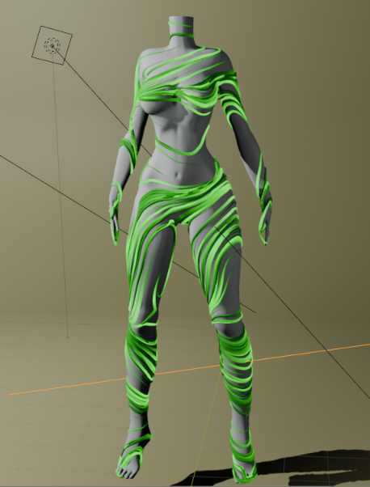
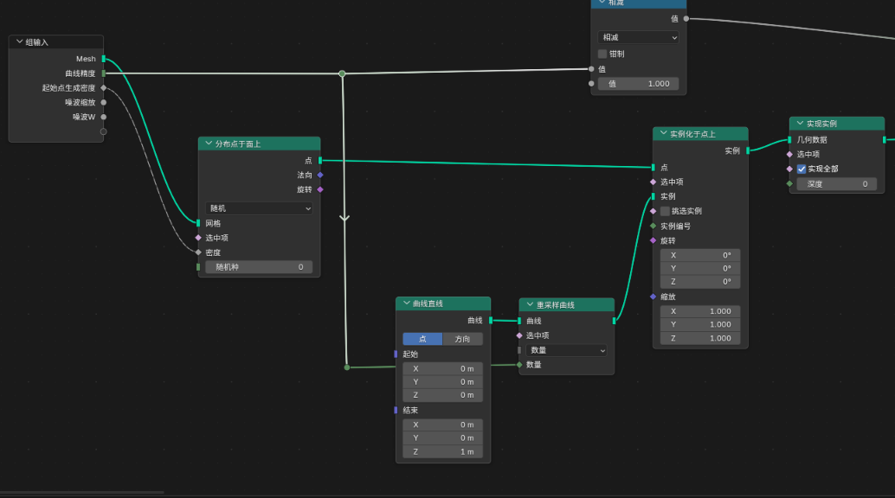
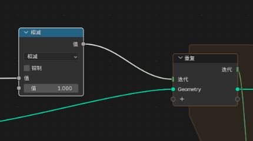
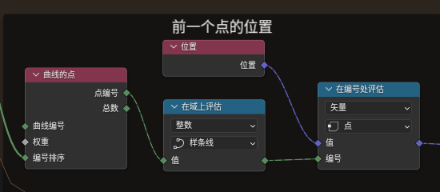
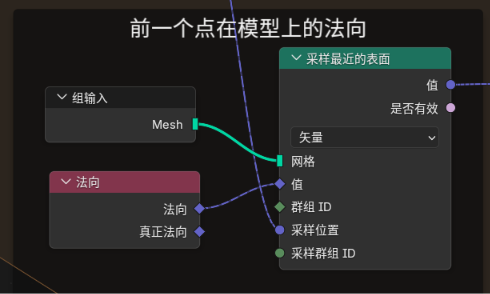
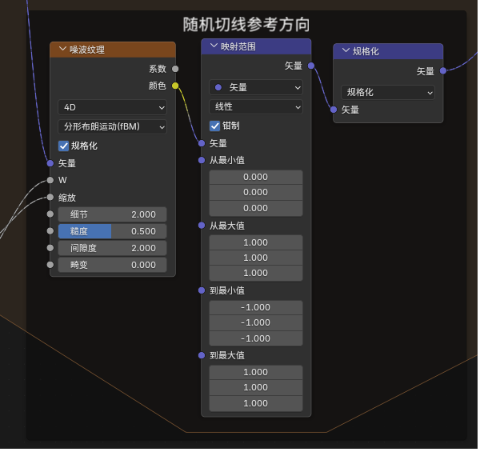
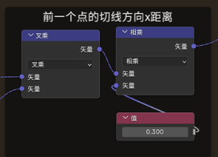
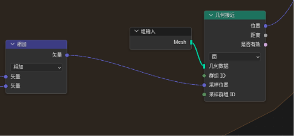
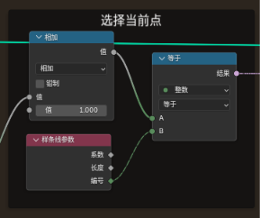
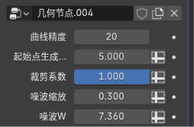

## curve flow body

blender 几何节点,实例化曲线,沿着模型表面的切线方向进行延申

### 预览

### 节点链接图
- 随机分布点在模型表面,并曲线实例化  

- 循环区域,迭代次数为曲线重采样次数-1,起点是在模型表面,为其他点计算在模型的坐标  

- 当前计算点的位置 = 上个点的位置 + 上个点的切线方向(ps: 上个点的法向 叉乘 噪波随机化的参照向量) 乘以 距离  

  - 上个点位置
    
  - 上个点在模型上的法向  
    
  - 随机切线参考方向  
    
  - 叉乘获取切线方向,并乘以距离,获取切线方向这个点的距离  
  
  - 让切线点的方向贴合模型表面  
  
  - 判断是否为当前点  
  

### 参数说明
    
  
  曲线精度: 曲线控制点数量
  起始点生成密度
  裁剪系数: 曲线裁剪系数,近似为长度
  噪波缩放: 计算切线的参考向量的噪波密度
  噪波W: 计算切线的参考向量的噪波W
